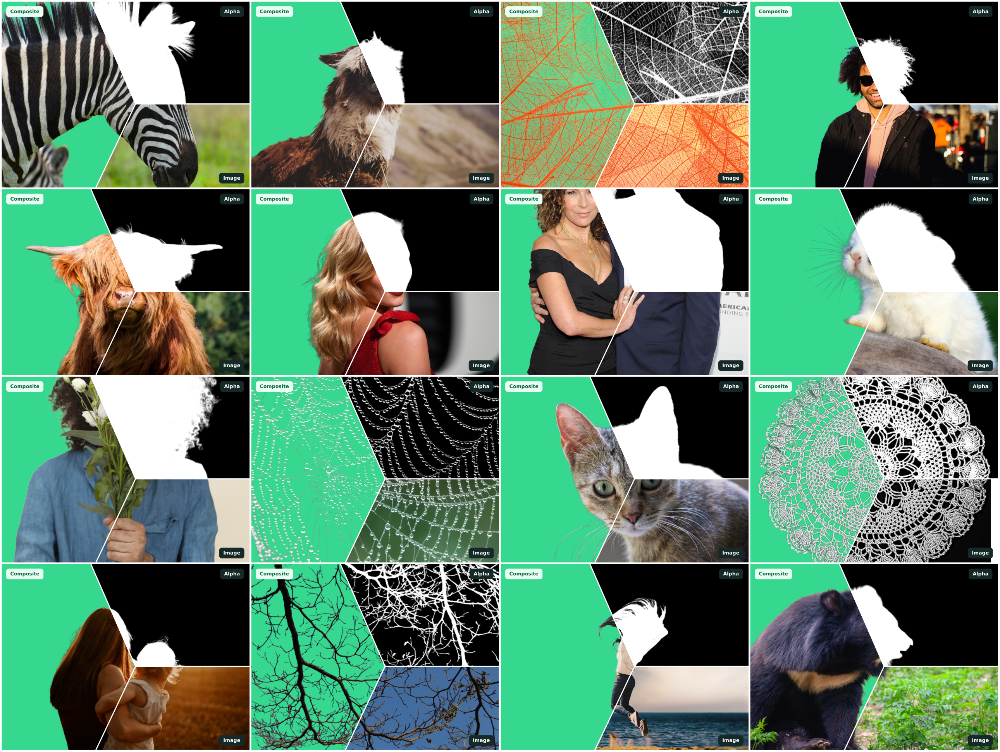

<div align="center">


# WeVisOne-VL

### オブジェクトからピクセルまでの統合視覚認識

<p>
  <a href="https://tencent.github.io/WeVisOne-VL"></a>
  <a href="https://arxiv.org/abs/2610.31329"></a>
  <a href="https://huggingface.co/tencent/WeVisOne-VL-2B"></a>
  <a href="https://huggingface.co/tencent/WeVisOne-VL-4B"></a>
  <a href="https://huggingface.co/spaces/hugging-apps/wevisone-vl-2b"></a>
  <a href="https://huggingface.co/spaces/hugging-apps/wevisone-vl-4b"></a>
  <a href="LICENSE"></a>
</p>

[English](README.md) | [简体中文](README_zh-CN.md) | **日本語**

</div>

> **WeVisOne-VL**（**We**Chat **Vis**ion All-in-**One**）は、構造化された次トークン予測と 960 万パラメータの軽量なピクセルデコーダーによって、**オブジェクトレベル**の認識（物体検出、参照表現による位置特定、カウント、ポインティング、OCR）と**ピクセルレベル**の認識（参照セグメンテーション、プロンプト可能なアルファマッティング）を統合したビジョン・ランゲージ基盤モデルです。点やボックスから二値マスク、連続的なアルファマットまで、ユーザーが指定した任意の粒度での位置特定を可能にしつつ、存在しない対象についてのクエリは確実に棄却します。



## ✨ ハイライト

- 🎯 **オールインワン**：検出、参照、カウント、ポインティング、OCR、セグメンテーション、マッティングを 1 つのモデルで実現します。
- 🪶 **軽量なピクセルデコーダー**：960 万パラメータのデコーダーがマスクとアルファマットを出力し、SAM は不要です。
- 🚫 **確実な棄却**：存在しない対象に対しては、ハルシネーションを起こさず `None` を返します。


## 📢 ニュース

- **[2026-10]** 🎮 デモを試せるようになりました：[2B](https://huggingface.co/spaces/hugging-apps/wevisone-vl-2b) / [4B](https://huggingface.co/spaces/hugging-apps/wevisone-vl-4b)。
- **[2026-10] 🔥🔥 WeVisOne-VL Data Engine で二値マスクを高品質なアルファマットに変換するために使用しているマッティングアノテーター [Mask2Alpha](https://github.com/Tencent/WeVisOne-VL/tree/mask2alpha) もオープンソース化しました！** [`mask2alpha`](https://github.com/Tencent/WeVisOne-VL/tree/mask2alpha) ブランチをご覧ください。
- **[2026-10]** 🎉 技術レポート、モデルの重み（2B & 4B）、推論パッケージ、Cookbooks、評価パイプラインを公開しました！


## 📝 TODO

- [x] 推論パッケージと Cookbooks
- [x] Gradio Web デモ
- [x] ベンチマーク評価パイプライン
- [x] Hugging Face でのモデルの重み（2B & 4B）の公開
- [x] マッティングアノテーターの公開
- [ ] ファインチューニング用コード


## 🏆 パフォーマンスの概要

各ベンチマークにおける最も強力なオープンなベースライン（9B までの Qwen3-VL / Qwen3.5、Rex-Omni、LocateAnything、およびタスク特化のセグメンテーション / マッティングモデル）と比較した、**WeVisOne-VL-4B** の主要な数値です。


| タスク               | ベンチマーク            | 指標      | 最良のベースライン | **WeVisOne-VL-4B** |
| ------------------ | -------------------- | ----------- | ------------- | ------------------ |
| 📦 検出       | LVIS                 | F1 Mean ↑   | 50.7          | **55.3**           |
| 📦 高密度検出 | Dense200             | F1 Mean ↑   | 58.7          | **71.3**           |
| 💬 参照       | RefCOCOg test        | F1 Mean ↑   | 77.6          | **81.8**           |
| 🚫 棄却       | WeRef-Bench          | Rej. Rate ↑ | 73.0          | **96.4**           |
| 🔢 カウント        | PixMo-Count test     | Acc ↑       | 82.8          | **89.6**           |
| 📍 ポインティング        | PointBench           | Acc ↑       | 69.9          | **71.9**           |
| 🔤 OCR             | TotalText            | F1 Mean ↑   | 43.3          | **52.0**           |
| 🎭 参照セグメンテーション  | ReasonSeg val        | gIoU ↑      | 65.0          | **71.2**           |
| ✂️ ボックスマッティング     | P3M-500-NP           | MAD ↓       | 15.4          | **7.3**            |
| ✂️ テキストマッティング    | WeRefMat (Referring) | MAD ↓       | 22.4          | **9.8**            |


#### 📊 全ベンチマーク結果（各タスクをクリックで展開）

検出、参照、OCR の F1 は、IoU しきい値 0.5:0.95 で平均した値（"Mean"）です。貪欲デコーディング、画像あたり ≤ 1,960 視覚トークン。

<details>
<summary><b>物体検出（F1 Mean）</b></summary>

| 手法             | COCO     | LVIS     | Dense200 | VisDrone |
| ------------------ | -------- | -------- | -------- | -------- |
| GroundingDINO-T    | 56.6     | 38.8     | 33.1     | 38.5     |
| Qwen3-VL-8B        | 47.8     | 42.9     | 13.8     | 29.5     |
| Qwen3.5-9B         | 49.5     | 43.7     | 18.0     | 31.3     |
| Rex-Omni-3B        | 52.9     | 46.9     | 58.3     | 35.8     |
| LocateAnything-3B  | 54.7     | 50.7     | 58.7     | 39.9     |
| **WeVisOne-VL-2B** | 55.2     | 53.3     | 61.4     | 40.4     |
| **WeVisOne-VL-4B** | **57.1** | **55.3** | **71.3** | **44.7** |

</details>

<details>
<summary><b>参照物体検出（F1 Mean / 棄却率 %）</b></summary>

| 手法             | RefCOCOg test | RefCOCOg Rej | WeRef Mean | WeRef Rej | HumanRef | Ref-L4   |
| ------------------ | ------------- | ------------ | ---------- | --------- | -------- | -------- |
| Qwen3-VL-8B        | 74.9          | 22.5         | 36.7       | 18.3      | 71.6     | 72.4     |
| Qwen3.5-9B         | 74.6          | 15.2         | 50.7       | 70.7      | 77.8     | 72.0     |
| Rex-Omni-3B        | 74.3          | 0.5          | 50.3       | 43.3      | 79.9     | 65.2     |
| LocateAnything-3B  | 77.6          | 0.6          | 51.7       | 73.0      | 78.7     | 74.3     |
| **WeVisOne-VL-2B** | 78.2          | 50.2         | 73.2       | 92.9      | 77.4     | 75.1     |
| **WeVisOne-VL-4B** | **81.8**      | **67.4**     | **78.7**   | **96.4**  | **80.7** | **78.1** |

</details>

<details>
<summary><b>物体カウント（完全一致の正解率 %）</b></summary>

| 手法             | CountQA  | PixMo-Count test | CLOC test | KubriCount testB | MixCount test |
| ------------------ | -------- | ---------------- | --------- | ---------------- | ------------- |
| Qwen3.5-9B         | 41.6     | 80.4             | 22.4      | 19.1             | 7.0           |
| Rex-Omni-3B        | 37.6     | 71.9             | 22.3      | 18.8             | 11.4          |
| LocateAnything-3B  | 52.4     | 82.8             | 23.9      | 22.4             | 15.2          |
| **WeVisOne-VL-2B** | 47.9     | 88.1             | 26.9      | 32.4             | 32.2          |
| **WeVisOne-VL-4B** | **57.1** | **89.6**         | **28.3**  | **40.1**         | **40.4**      |

</details>

<details>
<summary><b>物体ポインティング</b></summary>

| 手法             | PointBench | PixMo-Points | COCO     | LVIS     | Dense200 | VisDrone |
| ------------------ | ---------- | ------------ | -------- | -------- | -------- | -------- |
| Qwen3-VL-8B        | 62.5       | 72.2         | 77.5     | 67.7     | 42.2     | 46.4     |
| Rex-Omni-3B        | 69.9       | 72.9         | 80.5     | 70.8     | 82.5     | 58.9     |
| LocateAnything-3B  | 56.9       | 68.6         | 83.9     | 76.6     | **87.6** | 60.4     |
| **WeVisOne-VL-2B** | 62.9       | 73.2         | **85.8** | 78.9     | 83.2     | 62.4     |
| **WeVisOne-VL-4B** | **71.9**   | **74.7**     | 85.4     | **79.5** | 87.0     | **64.4** |

</details>

<details>
<summary><b>OCR — テキストのグラウンディングと認識（F1 Mean）</b></summary>

| 手法                | HierText | ICDAR2015 | TotalText | SROIE    |
| --------------------- | -------- | --------- | --------- | -------- |
| PP-OCRv5（特化モデル） | 30.5     | 25.6      | 25.7      | 58.6     |
| Qwen3-VL-8B           | 25.7     | 27.1      | 35.4      | 43.3     |
| Rex-Omni-3B           | 28.0     | 28.1      | 40.6      | 44.8     |
| LocateAnything-3B     | 29.4     | 24.1      | 43.3      | 40.3     |
| **WeVisOne-VL-2B**    | 30.5     | 42.6      | 42.5      | 62.1     |
| **WeVisOne-VL-4B**    | **39.0** | **47.8**  | **52.0**  | **68.1** |

</details>

<details>
<summary><b>参照セグメンテーション（cIoU。ReasonSeg は gIoU）</b></summary>

| 手法             | RefCOCO testA | RefCOCO+ testA | RefCOCOg test | ReasonSeg val | Ref-ZOM cIoU | Ref-ZOM Rej |
| ------------------ | ------------- | -------------- | ------------- | ------------- | ------------ | ----------- |
| LISA-13B (ft)      | 78.8          | 70.2           | 70.5          | 65.0          | -            | -           |
| GSVA-7B            | 78.9          | 69.6           | 73.3          | 50.5          | 66.6         | 41.9        |
| UniPixel-7B        | 83.0          | 80.1           | 77.1          | 60.5          | 62.9         | 0.3         |
| Youtu-VL-4B        | 82.0          | 79.6           | 76.6          | -             | 61.0         | 1.3         |
| **WeVisOne-VL-2B** | 82.9          | 79.0           | 74.9          | 60.9          | **73.4**     | 62.4        |
| **WeVisOne-VL-4B** | **84.5**      | **81.1**       | **77.8**      | **71.2**      | 72.2         | **86.0**    |

</details>

<details>
<summary><b>プロンプト可能なマッティング（MAD ×10³ ↓）</b></summary>

| 手法                    | P3M-500-NP (Box) | AM-2K (Box) | PPM-100 (Box) | WeRefMat (Category) | WeRefMat (Referring) |
| ------------------------- | ---------------- | ----------- | ------------- | ------------------- | -------------------- |
| Matte Anything            | 24.4             | 13.2        | 10.5          | -                   | -                    |
| SAM2-Matting (SAM3)       | 15.4             | 12.1        | 10.8          | 70.8                | 51.9                 |
| Qwen3.5-9B + SAM2-Matting | -                | -           | -             | 77.8                | 22.4                 |
| **WeVisOne-VL-2B**        | **6.6**          | 5.7         | **5.3**       | 17.7                | 15.8                 |
| **WeVisOne-VL-4B**        | 7.3              | **5.0**     | 6.1           | **16.4**            | **9.8**              |

</details>

すべてのデータ分割と指標については技術レポートを、公開ベンチマークの再現方法については [evaluation/README.md](evaluation/README.md) をご覧ください。


## 🏗️ 仕組み

**1. データエンジン。** ナレッジグラフ駆動のエンジンが概念を発見し、相補的な複数のエキスパートモデルでそれらの位置を特定して VLM で検証し、検証済みのボックスをマスクとアルファマットへ拡張します。この方法で 1 億枚以上の画像にアノテーションを付与しています。


**2. 統一されたタスク定式化。** すべてのタスクは構造化テキストとして記述され、ボックスと点には座標トークン `<0>` … `<1000>`、存在しない対象には `None`、ピクセルレベルの出力には各ボックスの後に `<OBJ>` トークンを使用します。


**3. モデルアーキテクチャ。** 960 万パラメータのピクセルデコーダーが、各 `<OBJ>` トークンの隠れ状態、その予測ボックス、および Qwen3-VL ViT のマルチレベル特徴を組み合わせて、フル解像度のマスクまたはアルファマットを予測します。


## 🚀 クイックスタート


### インストール

```bash
git clone https://github.com/Tencent/WeVisOne-VL.git && cd WeVisOne-VL
conda create -n wevisone-vl python=3.10 -y && conda activate wevisone-vl
pip install -r requirements.txt && pip install -v -e .
```


### 推論

```python
from PIL import Image
from wevisone_vl import WeVisOneVL
from wevisone_vl.visualization import save_result

model = WeVisOneVL("tencent/WeVisOne-VL-4B", backend="transformers")  # or backend="vllm"
# model = WeVisOneVL("tencent/WeVisOne-VL-2B", backend="transformers")  # Use 2B instead

# Object-level: open-vocabulary detection
image = Image.open("demo/examples/images/livingroom.jpg").convert("RGB")
result = model.predict(image, task="detection", query=["sofa", "pillow", "coffee table", "lamp"])
save_result("outputs/detection", image, result)

# Pixel-level: promptable alpha matting
image = Image.open("demo/examples/images/seabreeze.jpg").convert("RGB")
result = model.predict(image, task="matting", query="person")
save_result("outputs/matting", image, result)
```


<table>
  <tr>
    <td align="center"><br><sub>入力 · <code>query="person"</code></sub></td>
    <td align="center"><br><sub>予測されたアルファマット</sub></td>
    <td align="center"><br><sub>切り抜き</sub></td>
  </tr>
</table>


### 対応タスク


|     | `task`                      | `query`               | 出力                 |
| --- | --------------------------- | --------------------- | ---------------------- |
| 📦  | `detection`                 | カテゴリのリスト         | ボックス                  |
| 💬  | `referring`                 | 参照表現  | ボックスまたは `None`        |
| 📍  | `point`                     | カテゴリ / 表現 | 点                 |
| 🔢  | `count_box` / `count_point` | カテゴリ / 表現 | ボックス / 点 + 個数 |
| 🔤  | `ocr` / `ocr_grounding`     | – / 検索するテキスト      | テキスト + ボックス           |
| 🎭  | `segmentation`              | カテゴリ / 表現 | ボックス + 二値マスク   |
| ✂️  | `matting`                   | カテゴリ / 表現 | ボックス + アルファマット   |


> [!TIP]
> `device`（`"auto"`、`"cuda:0"`、`"npu:0"`、`"cpu"`）、`dtype`、`min_pixels` / `max_pixels`、および一般的なデコード引数（`max_new_tokens`、`temperature`、...）も利用できます。[Cookbooks](#-cookbooks) では各タスクを詳しく解説しています。


## 📓 Cookbooks


| チュートリアル                                                                    | 内容                                   |
| --------------------------------------------------------------------------- | ---------------------------------------- |
| 📦 [オブジェクトレベルのパイプライン](tutorials/01_object_level_pipeline.ipynb)        | 検出、参照、カウント、ポインティング |
| 🔤 [OCR パイプライン](tutorials/02_ocr_pipeline.ipynb)                          | OCR、テキストグラウンディング                      |
| 🎭 [ピクセルレベルのパイプライン](tutorials/03_segmentation_matting_pipeline.ipynb) | セグメンテーション、マッティング                    |


## 🎮 Gradio デモ

ホストされているデモを試す：[2B](https://huggingface.co/spaces/hugging-apps/wevisone-vl-2b) / [4B](https://huggingface.co/spaces/hugging-apps/wevisone-vl-4b)

ローカルでデモを起動する：

```bash
CUDA_VISIBLE_DEVICES=0 python demo/app.py --model tencent/WeVisOne-VL-4B
# Or use 2B:
# CUDA_VISIBLE_DEVICES=0 python demo/app.py --model tencent/WeVisOne-VL-2B
```

<details>
<summary>その他の起動オプション</summary>

```bash
# vLLM backend on a custom port, with a public share link
CUDA_VISIBLE_DEVICES=0 python demo/app.py \
    --model tencent/WeVisOne-VL-4B --backend vllm \
    --server-name 0.0.0.0 --server-port 8080 --share
```

</details>


## 📊 評価

[evaluation/README.md](evaluation/README.md) をご覧ください。

## 🖼️ 代表的な可視化結果

強力なベースラインとの並列比較です。タスクをクリックすると展開・折りたたみができます。

<details open>
<summary><b>参照検出</b> — 自然言語の表現で記述された物体の位置を特定します</summary>
<br>

</details>

<details open>
<summary><b>ボックスプロンプトによるマッティング</b> — 指定したボックス内の対象のアルファマットを予測します</summary>
<br>

</details>

<details open>
<summary><b>テキストプロンプトによるマッティング</b> — カテゴリ名または参照表現で指定した対象のアルファマットを予測します</summary>
<br>

</details>

<details>
<summary><b>物体検出</b> — 指定したカテゴリのすべてのインスタンスの位置をボックスで特定します</summary>
<br>

</details>

<details>
<summary><b>物体カウント</b> — カテゴリまたは表現に一致するインスタンスの数を数えます</summary>
<br>

</details>

<details>
<summary><b>物体ポインティング</b> — クエリで指定した各物体を点でマークします</summary>
<br>

</details>

<details>
<summary><b>OCR</b> — 画像内のテキストの位置を特定し、認識します</summary>
<br>

</details>

<details>
<summary><b>参照セグメンテーション</b> — 自然言語の表現で記述された物体をセグメンテーションします</summary>
<br>

</details>

## 📜 ライセンス

このリポジトリ内の Tencent が作成したコードは、[Apache License 2.0](LICENSE) の下で公開されています。サードパーティのコンポーネントは元のライセンスが維持されているため、該当するソースファイルをご確認ください。

## 📖 引用

WeVisOne-VL があなたの研究に役立った場合は、⭐ を付けていただき、以下のように引用をご検討ください：

```bibtex
@article{liang2026wevisone,
  title={WeVisOne-VL: Unified Visual Perception from Objects to Pixels},
  author={Liang, Tianming and Pan, Junyi and Li, Yuxi and Fu, Canmiao and Huang, Zhipeng and Sun, Chong and Li, Chen and Lyu, Jing},
  journal={arXiv preprint arXiv:2610.31329},
  year={2026}
}
```

